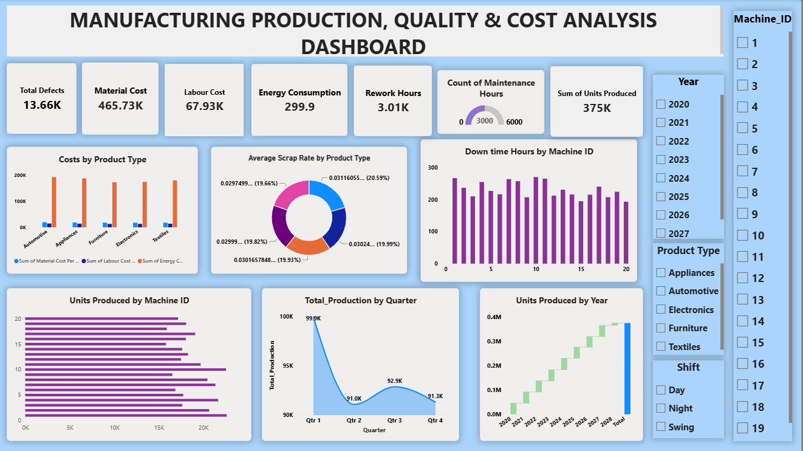

## 🖥️ Dashboard Preview

# Manufacturing Production, Quality & Cost Analysis Dashboard

An interactive manufacturing analytics dashboard built to analyze production performance, product quality, machine efficiency, and operational costs.

## 📊 Project Overview

This project focuses on analyzing manufacturing data to understand production trends, monitor product quality, evaluate operational costs, and identify opportunities for improving manufacturing efficiency.

The dashboard provides a consolidated view of key performance indicators (KPIs) and interactive visualizations to support data-driven decision-making.

## 🎯 Project Objectives

- Analyze manufacturing production across machines, quarters, and years.
- Monitor product defects, scrap rates, and rework hours.
- Evaluate material, labour, and energy costs across product categories.
- Analyze machine downtime and maintenance requirements.
- Compare manufacturing performance across different shifts.
- Identify opportunities to improve production efficiency and reduce operational costs.

## 📌 Key Performance Indicators (KPIs)

| KPI | Description |
|---|---|
| Total Defects | Total recorded manufacturing defects |
| Material Cost | Total expenditure on manufacturing materials |
| Labour Cost | Total labour-related manufacturing expenses |
| Energy Consumption | Total energy consumed during production |
| Rework Hours | Total hours spent correcting defective products |
| Maintenance Hours | Total recorded machine maintenance hours |
| Units Produced | Total manufacturing output |

## 📈 Dashboard Visualizations

The dashboard includes the following visualizations:

1. **Costs by Product Type** – Compares material, labour, and energy costs across product categories.
2. **Average Scrap Rate by Product Type** – Analyzes the average scrap rate across different product categories.
3. **Downtime Hours by Machine ID** – Identifies machine downtime and potential operational inefficiencies.
4. **Units Produced by Machine ID** – Compares production output across individual machines.
5. **Total Production by Quarter** – Tracks quarterly manufacturing production trends.
6. **Units Produced by Year** – Analyzes annual manufacturing output.

## 🔍 Interactive Filters

The dashboard provides interactive filters for:

- Machine ID
- Year
- Product Type
- Shift (Day, Night, Swing)

These filters allow users to explore manufacturing performance across different machines, time periods, product categories, and shifts.

## 💡 Key Insights

Based on the dashboard's displayed values:

- Total production reached approximately 375K units.
- Total defects were approximately 13.66K.
- Material costs reached approximately 465.73K.
- Labour costs were approximately 67.93K.
- Rework hours totaled approximately 3.01K.
- Quarterly production was highest in Q1, at approximately 99.9K units.
- Machine downtime varies across individual machines, highlighting potential opportunities for maintenance and operational improvements.
- Quality and cost analysis can help identify opportunities to reduce defects, scrap, and manufacturing expenses.

*Note: These values represent the overall dashboard figures and may change when interactive filters are applied.*

## 🛠️ Tools & Technologies

- Microsoft Power BI
- Data Visualization
- Manufacturing Data Analysis
- KPI Analysis
- Interactive Dashboard Design

## 📚 Skills Demonstrated

- Data analysis and interpretation
- Manufacturing KPI development
- Production and operational cost analysis
- Quality and defect analysis
- Trend and comparative analysis
- Data visualization and dashboard development
- Business intelligence and data-driven decision-making

## 📌 Project Outcome

This project demonstrates how manufacturing data can be transformed into an interactive dashboard to monitor production performance, analyze quality issues, evaluate operational costs, and identify opportunities for process improvement.

The dashboard provides meaningful insights into manufacturing operations and supports better operational decision-making.
